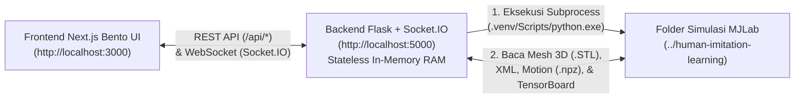

# Humanoid Imitation Learning Control & Visualization Platform — Booster K1 (22-DoF)

Platform berbasis web (**Next.js 14 Bento UI + Flask + Socket.IO + Three.js + MuJoCo**) untuk mengontrol, memantau secara *real-time* (*Stateless Ephemeral In-Memory Monitoring* tanpa database), memvisualisasikan simulasi 3D, menganalisis trajektori 22 sendi, serta mengekspor video MP4 dari *pipeline* **Humanoid Whole-Body Motion Imitation Learning (`GMR + BeyondMimic + MJLab / MuJoCo-Warp`)** pada robot **Booster K1 (22-DoF)**.

---

## Daftar Isi
1. [Arsitektur & Struktur Direktori](#1-arsitektur--struktur-direktori)
2. [Bagaimana Backend & Frontend Terhubung ke Folder Simulasi (`human-imitation-learning`)](#2-bagaimana-backend--frontend-terhubung-ke-folder-simulasi-human-imitation-learning)
3. [Dokumentasi & Cara Menjalankan Backend (Flask + Socket.IO)](#3-dokumentasi--cara-menjalankan-backend-flask--socketio)
4. [Dokumentasi & Cara Menjalankan Frontend (Next.js Bento UI)](#4-dokumentasi--cara-menjalankan-frontend-nextjs-bento-ui)
5. [Panduan Penggunaan Frontend (FE User Guide — 9 Menu Utama)](#5-panduan-penggunaan-frontend-fe-user-guide--9-menu-utama)
6. [Referensi REST API & Event Real-Time Socket.IO](#6-referensi-rest-api--event-real-time-socketio)
7. [Panduan Upload ke GitHub & Konfigurasi `.gitignore`](#7-panduan-upload-ke-github--konfigurasi-gitignore)

---

## 1. Arsitektur & Struktur Direktori

Proyek ini terdiri dari dua folder utama yang berdampingan di dalam satu *workspace* (`fp-ichiro/`):
- **`human-imitation-learning/`**: Folder utama *engine* simulasi fisika MuJoCo-Warp, *General Motion Retargeting* (GMR), dan *Reinforcement Learning* PPO BeyondMimic di MJLab.
- **`monitoring-control-imitation/`**: Folder platform web (*Backend Flask* + *Frontend Next.js*) yang mengontrol dan memvisualisasikan `human-imitation-learning/`.

```text
fp-ichiro/
├── human-imitation-learning/                 # [FOLDER SIMULASI & TRAINING IMITATION]
│   ├── .venv/                                # Virtual Environment Python 3.12 (PyTorch CUDA, MuJoCo, MJLab)
│   ├── data/
│   │   ├── bvh/                              # Data mocap gerakan manusia (.bvh)
│   │   ├── retargeted/                       # Hasil retargeting GMR (.csv & .pkl)
│   │   └── motions/k1_kick.npz               # Referensi gerakan 50 FPS siap simulasi & training
│   ├── logs/rsl_rl/k1_tracking/              # Folder log TensorBoard & checkpoint per iterasi (model_*.pt)
│   ├── outputs/
│   │   ├── checkpoints/k1_kick_policy.pt     # Checkpoint policy utama (.pt & .onnx)
│   │   ├── evaluation/                       # Hasil evaluasi (k1_metrics.json, rollout .npz, grafik .png)
│   │   └── videos/                           # Hasil render video simulasi (.mp4)
│   ├── scripts/
│   │   ├── train_ppo.py                      # Skrip utama training PPO BeyondMimic
│   │   ├── evaluate_and_play.py              # Skrip evaluasi kuantitatif & rekam video
│   │   └── ...
│   └── third_party/
│       ├── GMR/assets/booster_k1/            # Spesifikasi XML MuJoCo (k1_mjlab.xml) & 23 file mesh 3D (.STL)
│       └── mjlab/                            # Library simulator MJLab & task tracking Booster K1
│
└── monitoring-control-imitation/             # [FOLDER PLATFORM MONITORING & CONTROL WEB]
    ├── backend/                              # Modular Flask + Flask-SocketIO (Stateless In-Memory)
    │   ├── app/
    │   │   ├── models/database.py            # EphemeralRuntimeStore (In-Memory RAM Store, Tanpa Database)
    │   │   ├── routes/                       # 7 Blueprint REST API (dashboard, training, simulation, dll.)
    │   │   ├── services/                     # 5 Core Services (training, simulation, metrics, video, experiment)
    │   │   ├── sockets/events.py             # Handler WebSocket Real-Time (Socket.IO)
    │   │   ├── utils/system_monitor.py       # Monitor CPU/RAM/GPU/VRAM & validasi keamanan path
    │   │   └── __init__.py                   # App Factory Flask
    │   ├── config.py                         # Konfigurasi jembatan otomatis ke ../human-imitation-learning
    │   ├── extensions.py                     # Inisialisasi CORS & SocketIO
    │   ├── run.py                            # Entrypoint server Backend (Port 5000)
    │   └── requirements.txt
    ├── frontend/                             # Next.js 14 + React 18 + TypeScript + Tailwind Bento UI
    │   ├── src/
    │   │   ├── app/                          # Layout, Global Styles (.bento-card), & Halaman Utama (page.tsx)
    │   │   ├── components/
    │   │   │   ├── RobotCanvas3D.tsx         # 3D Three.js / React Three Fiber Viewer (23 Mesh STL + 6 POV)
    │   │   │   └── views/                    # 9 Komponen Halaman Modul (Overview, Training, Simulation, dll.)
    │   │   └── lib/api.ts                    # Klien HTTP Fetch & Koneksi Singleton Socket.IO ke Port 5000
    │   ├── next.config.mjs                   # Proxy rewrite otomatis /api/* & /socket.io/* ke Port 5000
    │   └── package.json
    ├── start_backend.ps1                     # Skrip PowerShell menjalankan Backend
    ├── start_frontend.ps1                    # Skrip PowerShell menjalankan Frontend
    ├── start_platform.ps1                    # Skrip 1-klik menjalankan Backend & Frontend bersamaan
    ├── .gitignore                            # Proteksi file sensitif & artefak besar saat push ke GitHub
    └── README.md
```

---

## 2. Bagaimana Backend & Frontend Terhubung ke Folder Simulasi (`human-imitation-learning`)

Hubungan antara **Frontend (`Port 3000`)**, **Backend (`Port 5000`)**, dan **Folder Simulasi (`human-imitation-learning`)** berjalan secara **otomatis dan langsung (*direct integration*)** tanpa duplikasi *pipeline*:



### A. Jembatan Konfigurasi di `backend/config.py`
Pada file [`backend/config.py`](./backend/config.py), backend secara otomatis mendeteksi lokasi folder `human-imitation-learning` relatif terhadap folder proyek:

```python
BACKEND_DIR = pathlib.Path(__file__).resolve().parent
PROJECT_ROOT = BACKEND_DIR.parent
WORKSPACE_ROOT = PROJECT_ROOT.parent
HIL_ROOT = (WORKSPACE_ROOT / "human-imitation-learning").resolve()
```

Dari `HIL_ROOT` tersebut, Backend langsung memetakan seluruh komponen simulasi asli:
1. **Interpreter Python & CUDA (`PYTHON_EXE`)**:
   - Mengarah ke `human-imitation-learning/.venv/Scripts/python.exe`.
   - Memastikan proses training dan render MuJoCo menggunakan PyTorch CUDA, `mujoco==3.16.0`, `mujoco-warp`, dan `mjlab` yang sudah terpasang di `.venv` simulasi.
2. **Eksekusi Training & Evaluasi (`SCRIPTS_DIR`)**:
   - Saat tombol **Start PPO** ditekan di web, [`training_service.py`](./backend/app/services/training_service.py) menjalankan subprocess:
     `human-imitation-learning/.venv/Scripts/python.exe -u scripts/train_ppo.py --robot booster_k1 ...`
   - Saat tombol **Evaluate Policy** ditekan, backend menjalankan `scripts/evaluate_and_play.py`.
   - Seluruh output terminal (`stdout`/`stderr`) ditangkap baris demi baris dan dipancarkan secara *live* ke browser melalui **Socket.IO** (`event: training_log`).
3. **Pembacaan Geometri 3D Robot & XML (`K1_ASSETS_DIR` & `K1_MESHES_DIR`)**:
   - Mengarah ke `human-imitation-learning/third_party/GMR/assets/booster_k1/k1_mjlab.xml` dan folder `meshes/*.STL`.
   - Endpoint `/api/simulation/meshes/<nama_file>.STL` mengirimkan ke-23 file mesh `.STL` asli (`Trunk.STL`, `Head_1.STL`, `Head_2.STL`, lengan, paha, betis, dan kaki) langsung ke komponen Three.js (`RobotCanvas3D.tsx`) di Frontend.
4. **Pembacaan Data Gerakan (`MOTIONS_DIR`) & Rollout Simulasi (`EVALUATION_DIR`)**:
   - Membaca `data/motions/k1_kick.npz` (149 frame @ 50 FPS gerakan referensi GMR) dan `outputs/evaluation/k1_rollout_trajectory.npz` (hasil *rollout* tertutup *policy* PPO di MJLab) untuk membandingkan posisi 3D, kuaternion orientasi, sudut sendi, dan kecepatan 22 sendi pada setiap frame.
5. **Pembacaan Log TensorBoard (`LOGS_DIR`) & Checkpoint (`CHECKPOINTS_DIR`)**:
   - Membaca file `events.out.tfevents.*` di `logs/rsl_rl/k1_tracking/<nama_run>/` menggunakan `EventAccumulator` secara langsung ke RAM tanpa database.

> **Catatan Keamanan (`safe_resolve_in_hil`)**: Fungsi validasi di [`system_monitor.py`](./backend/app/utils/system_monitor.py) memastikan bahwa semua *path* file yang diminta dari Frontend harus berada di dalam direktori `human-imitation-learning` dan memvalidasi tipe setiap parameter sebelum menjalankan subprocess (mencegah *arbitrary shell command execution*).

### B. Koneksi Frontend ke Backend (`frontend/src/lib/api.ts`)
- Pada [`frontend/src/lib/api.ts`](./frontend/src/lib/api.ts), `API_BASE` diatur secara default ke `http://127.0.0.1:5000`.
- Pada [`frontend/next.config.mjs`](./frontend/next.config.mjs), terdapat aturan *rewrite proxy* sehingga request ke `/api/*` dan `/socket.io/*` otomatis diteruskan ke `http://127.0.0.1:5000`.
- Koneksi **Socket.IO** diinisialisasi otomatis ketika aplikasi dibuka. Indikator titik hijau di bagian atas sidebar menandakan WebSocket antara Frontend dan Backend sedang terhubung secara *live*.

---

## 3. Dokumentasi & Cara Menjalankan Backend (Flask + Socket.IO)

### Karakteristik Backend
- **Stateless Ephemeral In-Memory Mode (Tanpa Database)**: Tidak memerlukan instalasi PostgreSQL maupun file database SQLite. Seluruh status monitoring disimpan di RAM selama sesi berjalan melalui [`EphemeralRuntimeStore`](./backend/app/models/database.py).
- **Sekali Simulasi Langsung Dibuang**: Ketika simulasi dihentikan atau tombol **Discard Sim Buffer / Reset & Discard Buffer** ditekan, *cache* dan *buffer* simulasi sementara di memori langsung dihapus (`POST /api/simulation/discard`).

### Langkah Menjalankan Backend
Buka terminal **PowerShell** dan jalankan menggunakan Python dari `.venv` simulasi:

```powershell
cd C:\Users\ASUS\Documents\fp-ichiro\monitoring-control-imitation
..\human-imitation-learning\.venv\Scripts\python.exe backend\run.py
```
*(Atau cukup jalankan skrip `.\start_backend.ps1`)*

- Server Backend akan aktif di: **`http://localhost:5000`**
- Cek kesehatan server di browser: **`http://localhost:5000/api/health`**
  ```json
  {
    "service": "booster-k1-imitation-control-backend",
    "status": "ok",
    "storage_mode": "ephemeral_in_memory_no_database"
  }
  ```

---

## 4. Dokumentasi & Cara Menjalankan Frontend (Next.js Bento UI)

### Karakteristik Frontend
- Menggunakan **Next.js 14 (App Router)**, **React 18**, **TypeScript**, **Tailwind CSS**, **Recharts**, dan **Three.js (`@react-three/fiber` & `@react-three/drei`)**.
- Mengusung desain **Clean Bento Grid** (*Off-White Canvas `#F3F4F6`, Crisp White Cards `rounded-[22px]`, Lime Green `#84CC16`, Warm Orange `#FB923C`, dan Deep Charcoal `#18181B`*).

### Langkah Menjalankan Frontend
1. **(Hanya Pertama Kali)** Instal dependensi Node.js:
   ```powershell
   cd C:\Users\ASUS\Documents\fp-ichiro\monitoring-control-imitation\frontend
   npm install
   ```
2. Jalankan server *development* Next.js:
   ```powershell
   npm run dev
   ```
   *(Atau jalankan `.\start_frontend.ps1` dari folder `monitoring-control-imitation`)*
3. Buka browser dan akses: **`http://localhost:3000`**

> **Tips Cepat (1 Perintah untuk Backend + Frontend)**:
> Dari folder `monitoring-control-imitation`, Anda cukup menjalankan:
> ```powershell
> .\start_platform.ps1
> ```

---

## 5. Panduan Penggunaan Frontend (FE User Guide — 9 Menu Utama)

Berikut panduan penggunaan setiap menu yang ada di sidebar aplikasi:

### 1. `Dashboard` (Overview Bento Grid)
Pusat ringkasan metrik dan kontrol cepat:
- **Hero Convergence Chart (Kiri Atas)**: Menampilkan kenaikan *Mean Return* (`+16.41`, puncak `+19.70`) dan penurunan residu error sepanjang kurikulum training (`Iter 0` s/d `Iter 2495`). Anda dapat mengganti tampilan antara **Bar View** dan **Line Curve View** di pojok kanan atas grafik.
- **Joint Tracking Accuracy Threshold (Tengah Kiri)**: Progress bar bergaris diagonal hijau limau yang membandingkan akurasi sudut sendi saat ini (`0.1470 rad` / `8.42°`) terhadap target batas maksimum (`0.2000 rad`).
- **Kinematic Error Split & Stability Health Gauge (Bawah)**: Menampilkan pembagian persentase error per kelompok anggota tubuh (kaki tendang kanan, kaki tumpu kiri, lengan, kepala) serta busur *gauge* persentase keberhasilan penyelesaian gerakan (`65.62%` / `168 dari 256` episode).
- **Active Policy Card & Quick Camera POV Launch (Kolom Kanan)**:
  - Menampilkan *checkpoint* aktif (`k1_kick_policy.pt @ 50 Hz`).
  - **5 Tombol Kotak Aksi Cepat**: `3D Sim` (buka simulasi 3D), `Train` (buka kontrol training), `Motion` (analisis sendi), `Video` (buat MP4), dan `Discard` (buang *buffer* simulasi dari RAM).
  - **6 Avatar Bulat Camera POV (`3P`, `FR`, `SD`, `TP`, `OR`, `FP`)**: Klik salah satu lingkaran untuk langsung melompat ke halaman **3D Simulation** dengan sudut kamera tersebut!

### 2. `Training Center` (Kontrol Proses Training PPO MJLab)
Digunakan untuk menjalankan atau melanjutkan (*resume*) proses training PPO `scripts/train_ppo.py` langsung dari browser:
- **Bar Telemetri Hardware (Atas)**: Memantau persentase pemakaian **CPU**, **System RAM**, **GPU Compute (CUDA)**, dan **GPU VRAM** secara *real-time*.
- **Form Konfigurasi PPO (Kiri)**:
  - Pilih **Reference Motion** (`data/motions/k1_kick.npz`).
  - Pilih **Resume From Checkpoint** (pilih `-- Train From Scratch --` untuk melatih dari nol, atau pilih salah satu `model_*.pt` / `k1_kick_policy.pt` untuk *finetuning*).
  - Atur `Parallel Envs` (default `2048`, turunkan ke `1024` atau `512` jika VRAM penuh), `Max Iters`, `Save Every`, dan `Run Tag`.
- **Tombol Kontrol Eksekusi**:
  - **Start PPO**: Menjalankan proses training MJLab di latar belakang.
  - **Pause**: Membekukan (*suspend*) proses training sementara.
  - **Resume**: Melanjutkan proses training yang di-*pause*.
  - **Stop**: Menghentikan proses training dengan aman.
  - **Evaluate Policy**: Menjalankan `scripts/evaluate_and_play.py` pada *checkpoint* terpilih.
- **Live Terminal Stream (Kanan Bawah)**: Menampilkan keluaran `stdout`/`stderr` langsung dari proses Python MJLab secara *real-time*.

### 3. `3D Simulation` (Interactive 3D Humanoid Viewer & 6 Camera POVs)
Merender robot **Booster K1 (22-DoF)** menggunakan mesh `.STL` asli di ruang 3D WebGL (Three.js):
- **6 Tombol Camera POV (Tanpa Restart Simulasi)**:
  1. `1. Third-Person`: Kamera mengikuti tubuh (`Trunk`) robot dari belakang.
  2. `2. Front View`: Kamera menghadap bagian depan robot.
  3. `3. Side View`: Kamera dari samping untuk mengamati ketinggian tendangan kaki kanan.
  4. `4. Top View`: Kamera dari atas (*bird's-eye view*) untuk melihat jejak keseimbangan.
  5. `5. Free Orbit`: Gunakan *mouse* (klik kiri tahan untuk putar, *scroll* untuk *zoom*, klik kanan tahan untuk geser).
  6. `6. First-Person (Head POV)`: Kamera ditempelkan langsung pada posisi dan orientasi mata/kepala robot (`Head_2` link) lengkap dengan *HUD Visor Reticle* sehingga Anda melihat persis apa yang dilihat kepala robot saat menendang!
- **Mode Tampilan**:
  - `Side-by-Side`: Menampilkan robot referensi GMR (biru transparan) dan robot hasil *policy* PPO (solid) berdampingan.
  - `Ghost Overlay`: Menumpuk robot referensi dan *policy* di titik yang sama untuk melihat selisih gerakan secara langsung.
  - `Error Heatmap`: Mewarnai bagian tubuh robot menjadi **Hijau** (error rendah), **Oranye** (error sedang), atau **Merah** (error tinggi $> 75\text{ mm}$) secara dinamis per frame.
  - `MuJoCo Native Stream`: Membuka jendela *Picture-in-Picture* yang merender frame asli langsung dari *C++ Offscreen Renderer* MuJoCo.
- **Tombol `Reset & Discard Buffer`**: Menghentikan simulasi dan langsung membuang *buffer* simulasi dari memori server.

### 4. `Telemetry & Media` $\rightarrow$ `Motion Analysis`
Halaman analisis detail untuk ke-22 sendi (*22-DoF*):
- Pilih **Primary Joint** (misalnya `Right_Hip_Pitch` atau `Right_Knee_Pitch`) dan **Comparison Joint** dari *dropdown*.
- Menampilkan 4 grafik interaktif:
  1. Sudut sendi Referensi GMR vs *Policy* PPO (`rad`).
  2. Residu error instan $|q_{\text{sim}}(t) - q_{\text{ref}}(t)|$ terhadap batas target `0.20 rad`.
  3. Kecepatan sudut sendi (`rad/s`).
  4. Ketinggian 3D telapak kaki penendang (`right_foot_link` Z dalam meter).
- **Tabel 22-DoF di Bawah**: Menyoroti sendi dengan error signifikan (`Significant Error`) dan memungkinkan Anda memfilter berdasarkan tingkat keparahan (`all`, `high`, `moderate`, `optimal`). Klik baris sendi mana pun untuk langsung memuat grafiknya.

### 5. `Telemetry & Media` $\rightarrow$ `Analytics & Plots`
Halaman evaluasi performa dan ekspor laporan ilmiah:
- **Session Filter**: Filter metrik berdasarkan sesi training tertentu atau seluruh kurikulum (`Iter 0–2495`).
- **Tombol Ekspor (Kanan Atas)**:
  - **Export CSV**: Mengunduh tabel deret waktu metrik iterasi dalam format `.csv`.
  - **Export JSON**: Mengunduh laporan lengkap metrik evaluasi dan kurva training dalam format `.json`.
  - **Matplotlib Report PNG**: Merender dan membuka grafik ilmiah 4-panel beresolusi tinggi via `Matplotlib`.
- **Multi-Checkpoint Comparison**: Pilih beberapa *checkpoint* untuk membandingkan penurunan `R-MPKPE (mm)` dan kenaikan `Mean Reward` pada diagram batang.

### 6. `Telemetry & Media` $\rightarrow$ `Video Studio`
Pusat pembuatan dan pengunduhan video eksperimen `.mp4`:
- Pilih **Recording Mode**:
  - `Side-by-Side Comparison (Ref vs Policy)`
  - `Export Generated Policy Motion as MP4`
  - `Export Kinematic Reference Motion as MP4`
  - `Policy Recording with Tracking Error Telemetry HUD Overlay`
- Pilih salah satu dari **6 Camera POV** (termasuk `First-Person Robot Head_2 POV`), resolusi (`640x480` hingga `1920x1080`), `FPS` (`25`–`60`), dan kecepatan putar (`0.25x` *slow-motion* hingga `2.0x`).
- Klik **Generate MP4 Experiment Video**: *Job* berjalan secara *asynchronous* di latar belakang (progress bar `0%` $\rightarrow$ `100%` tampil *live*), lalu video langsung dapat diputar di *player* sebelah kanan atau diunduh lewat tombol **Download MP4**.

### 7. `Experiments`
Menampilkan daftar sesi eksperimen beserta deskripsi, rentang iterasi, daftar *checkpoint* terkait, dan konsol **TensorBoard Iteration Log** per sesi.

### 8. `Checkpoints`
Repositori seluruh file *policy* PyTorch (`.pt`) dan ONNX (`.onnx`). Anda dapat mengklik **3D Viewer** pada *checkpoint* mana saja untuk memuat *checkpoint* tersebut ke simulasi 3D, atau mengunduh file `.PT` dan `.ONNX`-nya.

### 9. `System Settings`
Menampilkan informasi *path* integrasi repositori `human-imitation-learning`, status **Stateless Ephemeral In-Memory Monitoring (No Database Used)**, spesifikasi simulator, serta tombol pengubah tema **Light / Dark Mode**.

---

## 6. Referensi REST API & Event Real-Time Socket.IO

| Method | Endpoint | Deskripsi |
| :--- | :--- | :--- |
| `GET` | `/api/health` | Status kesehatan server backend & mode *storage* (`ephemeral_in_memory_no_database`). |
| `GET` | `/api/dashboard/overview` | Ringkasan KPI dashboard, kurva progres 2.495 iterasi, performa 22 sendi, dan telemetri hardware. |
| `GET` | `/api/training/options` | Daftar robot, environment MJLab, dataset `.npz`, `.csv`, `.bvh`, dan daftar *checkpoint*. |
| `GET` | `/api/training/status` | Status proses training aktif (`idle`, `running`, `paused`, `completed`), PID, & utilisasi CPU/GPU. |
| `POST` | `/api/training/start` | Memvalidasi parameter & menjalankan subprocess `scripts/train_ppo.py`. |
| `POST` | `/api/training/pause` | Membekukan (*suspend*) proses training yang sedang berjalan. |
| `POST` | `/api/training/resume` | Melanjutkan proses training yang sedang dibekukan. |
| `POST` | `/api/training/stop` | Menghentikan proses training dengan aman. |
| `POST` | `/api/training/evaluate` | Menjalankan evaluasi `scripts/evaluate_and_play.py` di latar belakang. |
| `GET` | `/api/simulation/schema` | Skema kinematik 23 *body links*, 22 sendi, 14 *keybodies*, dan daftar mesh `.STL` Booster K1. |
| `GET` | `/api/simulation/meshes/<file>` | Mengirimkan file mesh 3D `.STL` asli Booster K1. |
| `GET` | `/api/simulation/trajectory` | Data trajektori 149 frame @ 50 FPS (`ref` vs `sim`), error per sendi/body, & pose kamera `Head_2`. |
| `GET` | `/api/simulation/render-frame` | Merender frame kamera MuJoCo C++ offscreen (JPEG Base64) untuk 6 mode POV. |
| `POST` | `/api/simulation/discard` | Langsung membuang *buffer* dan *cache* simulasi dari memori (ephemeral mode). |
| `GET` | `/api/analytics/summary` | Metrik evaluasi lengkap & deret scalar TensorBoard. |
| `GET` | `/api/analytics/export` | Unduh hasil eksperimen dalam format `CSV` atau `JSON`. |
| `GET` | `/api/analytics/report.png` | Render grafik laporan konvergensi 4-panel via `Matplotlib`. |
| `POST` | `/api/videos/generate` | Menjalankan *background job* pembuatan video MP4 MuJoCo + FFmpeg. |
| `GET` | `/api/videos/stream/<id>` | Streaming video MP4 untuk preview HTML5 `<video>`. |
| `GET` | `/api/videos/download/<id>` | Mengunduh file video MP4. |


