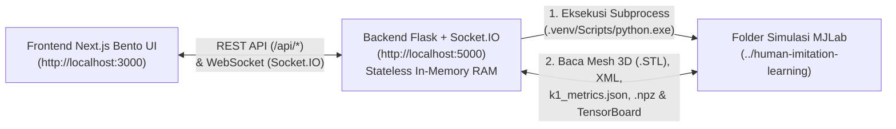

# Humanoid Imitation Learning Control & Visualization Platform — Booster K1 (22-DoF)

Platform berbasis web (**Next.js 14 Bento UI + Flask + Socket.IO + Three.js + MuJoCo**) untuk mengontrol, memantau secara *real-time* (**Stateless Ephemeral In-Memory Monitoring — Tanpa Database & Tanpa Data Dummy**), memvisualisasikan simulasi 3D, menganalisis trajektori 22 sendi, serta mengekspor video MP4 dari *pipeline* **Humanoid Whole-Body Motion Imitation Learning (`GMR + BeyondMimic + MJLab / MuJoCo-Warp`)** pada robot **Booster K1 (22-DoF)**.

---

## Daftar Isi
1. [Arsitektur & Prinsip 100% Data Asli (Zero Dummy Data & Zero Database)](#1-arsitektur--prinsip-100-data-asli-zero-dummy-data--zero-database)
2. [Bagaimana Backend & Frontend Terhubung ke Folder Simulasi (`human-imitation-learning`)](#2-bagaimana-backend--frontend-terhubung-ke-folder-simulasi-human-imitation-learning)
3. [Dokumentasi & Cara Menjalankan Backend (Flask + Socket.IO)](#3-dokumentasi--cara-menjalankan-backend-flask--socketio)
4. [Dokumentasi & Cara Menjalankan Frontend (Next.js Bento UI)](#4-dokumentasi--cara-menjalankan-frontend-nextjs-bento-ui)
5. [Panduan Penggunaan Frontend (FE User Guide — 9 Menu Utama)](#5-panduan-penggunaan-frontend-fe-user-guide--9-menu-utama)
6. [Referensi REST API & Event Real-Time Socket.IO](#6-referensi-rest-api--event-real-time-socketio)
7. [Panduan Upload ke GitHub & Konfigurasi `.gitignore`](#7-panduan-upload-ke-github--konfigurasi-gitignore)

---

## 1. Arsitektur & Prinsip 100% Data Asli (Zero Dummy Data & Zero Database)

Platform ini dirancang dengan dua prinsip utama:
1. **100% Data Asli dari Pipeline Simulasi (Tanpa Data Dummy / Tanpa Angka Fallback Statis)**:
   - Seluruh angka, grafik, tabel sendi, dan kartu di Frontend diambil langsung dari file hasil eksekusi MJLab di folder `human-imitation-learning`:
     - **Log TensorBoard Asli**: `logs/rsl_rl/k1_tracking/<run_dir>/events.out.tfevents.*` (`Train/mean_reward`, `Train/mean_episode_length`, `Loss/value`, `Loss/surrogate`, `Metrics/motion/error_body_pos`, `Metrics/motion/error_joint_pos`, `Episode_Reward/*`, `Episode_Termination/*`, `Perf/total_fps`).
     - **Metrik Evaluasi Kuantitatif Asli**: `outputs/evaluation/k1_metrics.json` (`joint_tracking_mae_rad`, `joint_tracking_rmse_rad`, `r_mpkpe_mm`, `mpkpe_mm`, `end_effector_hand_error_mm`, `end_effector_foot_error_mm`, `anchor_orientation_error_rad`, `success_rate_percent`, dan `per_joint_metrics` untuk 22 sendi).
     - **Trajektori Kinematik & Rollout Fisika Asli**: `data/motions/k1_kick.npz` (referensi GMR 149 frame @ 50 FPS) dan `outputs/evaluation/k1_rollout_trajectory.npz` (*rollout* tertutup *policy* PPO di MuJoCo-Warp).
     - **Telemetri Hardware Asli**: Utilisasi CPU, RAM, GPU CUDA, dan VRAM langsung dari `psutil` dan `nvidia-smi`.
   - Jika suatu metrik belum dievaluasi atau proses training sedang `idle`, UI akan menampilkan **`—`** (bukan angka karangan/dummy).
2. **Stateless Ephemeral In-Memory Monitoring (Tanpa Database)**:
   - Tidak menggunakan PostgreSQL maupun file SQLite (`.db`).
   - Seluruh status monitoring berjalan di RAM (`EphemeralRuntimeStore`). Begitu simulasi di-*reset* atau tombol **Discard Sim Buffer** ditekan, *buffer* simulasi langsung dibuang dari memori.

### Struktur Direktori Workspace

```text
fp-ichiro/
├── human-imitation-learning/                 # [FOLDER SIMULASI & TRAINING IMITATION]
│   ├── .venv/                                # Virtual Environment Python 3.12 (PyTorch CUDA, MuJoCo, MJLab)
│   ├── data/
│   │   ├── bvh/                              # Data mocap gerakan manusia (.bvh)
│   │   ├── retargeted/                       # Hasil retargeting GMR (.csv & .pkl)
│   │   └── motions/k1_kick.npz               # Referensi gerakan 50 FPS siap simulasi & training
│   ├── logs/rsl_rl/k1_tracking/              # Folder log TensorBoard & checkpoint per iterasi (model_*.pt)
│   ├── outputs/
│   │   ├── checkpoints/k1_kick_policy.pt     # Checkpoint policy utama (.pt & .onnx)
│   │   ├── evaluation/                       # Hasil evaluasi (k1_metrics.json, rollout .npz, grafik .png)
│   │   └── videos/                           # Hasil render video simulasi (.mp4)
│   ├── scripts/
│   │   ├── train_ppo.py                      # Skrip utama training PPO BeyondMimic
│   │   ├── evaluate_and_play.py              # Skrip evaluasi kuantitatif & rekam video
│   │   └── ...
│   └── third_party/
│       ├── GMR/assets/booster_k1/            # Spesifikasi XML MuJoCo (k1_mjlab.xml) & 23 file mesh 3D (.STL)
│       └── mjlab/                            # Library simulator MJLab & task tracking Booster K1
│
└── monitoring-control-imitation/             # [FOLDER PLATFORM MONITORING & CONTROL WEB]
    ├── backend/                              # Modular Flask + Flask-SocketIO (Stateless In-Memory)
    │   ├── app/
    │   │   ├── models/database.py            # EphemeralRuntimeStore (In-Memory RAM Store, Tanpa Database)
    │   │   ├── routes/                       # 7 Blueprint REST API (dashboard, training, simulation, dll.)
    │   │   ├── services/                     # 5 Core Services (training, simulation, metrics, video, experiment)
    │   │   ├── sockets/events.py             # Handler WebSocket Real-Time (Socket.IO)
    │   │   ├── utils/system_monitor.py       # Monitor CPU/RAM/GPU/VRAM & validasi keamanan path
    │   │   └── __init__.py                   # App Factory Flask
    │   ├── config.py                         # Konfigurasi jembatan otomatis ke ../human-imitation-learning
    │   ├── extensions.py                     # Inisialisasi CORS & SocketIO
    │   ├── run.py                            # Entrypoint server Backend (Port 5000)
    │   └── requirements.txt
    ├── frontend/                             # Next.js 14 + React 18 + TypeScript + Tailwind Bento UI
    │   ├── src/
    │   │   ├── app/                          # Layout, Global Styles (.bento-card), & Halaman Utama (page.tsx)
    │   │   ├── components/
    │   │   │   ├── RobotCanvas3D.tsx         # 3D Three.js / React Three Fiber Viewer (23 Mesh STL + 6 POV)
    │   │   │   └── views/                    # 9 Komponen Halaman Modul (100% Real Pipeline Data)
    │   │   └── lib/api.ts                    # Klien HTTP Fetch & Koneksi Singleton Socket.IO ke Port 5000
    │   ├── next.config.mjs                   # Proxy rewrite otomatis /api/* & /socket.io/* ke Port 5000
    │   └── package.json
    ├── start_backend.ps1                     # Skrip PowerShell menjalankan Backend
    ├── start_frontend.ps1                    # Skrip PowerShell menjalankan Frontend
    ├── start_platform.ps1                    # Skrip 1-klik menjalankan Backend & Frontend bersamaan
    ├── .gitignore                            # Proteksi file sensitif & artefak besar saat push ke GitHub
    └── README.md
```

---

## 2. Bagaimana Backend & Frontend Terhubung ke Folder Simulasi (`human-imitation-learning`)

Hubungan antara **Frontend (`Port 3000`)**, **Backend (`Port 5000`)**, dan **Folder Simulasi (`human-imitation-learning`)** berjalan secara **otomatis dan langsung (*direct integration*)**:



### A. Jembatan Konfigurasi di `backend/config.py`
Pada file [`backend/config.py`](./backend/config.py), backend secara otomatis mendeteksi lokasi folder `human-imitation-learning` relatif terhadap folder proyek:

```python
BACKEND_DIR = pathlib.Path(__file__).resolve().parent
PROJECT_ROOT = BACKEND_DIR.parent
WORKSPACE_ROOT = PROJECT_ROOT.parent
HIL_ROOT = (WORKSPACE_ROOT / "human-imitation-learning").resolve()
```

Dari `HIL_ROOT` tersebut, Backend langsung memetakan seluruh komponen simulasi asli:
1. **Interpreter Python & CUDA (`PYTHON_EXE`)**:
   - Mengarah ke `human-imitation-learning/.venv/Scripts/python.exe`.
   - Memastikan proses training dan render MuJoCo menggunakan PyTorch CUDA, `mujoco==3.16.0`, `mujoco-warp`, dan `mjlab` yang sudah terpasang di `.venv` simulasi.
2. **Eksekusi Training & Evaluasi (`SCRIPTS_DIR`)**:
   - Saat tombol **Start PPO** ditekan di web, [`training_service.py`](./backend/app/services/training_service.py) menjalankan subprocess:
     `human-imitation-learning/.venv/Scripts/python.exe -u scripts/train_ppo.py --robot booster_k1 ...`
   - Saat tombol **Evaluate Policy** ditekan, backend menjalankan `scripts/evaluate_and_play.py`.
   - Seluruh output terminal (`stdout`/`stderr`) ditangkap baris demi baris dan dipancarkan secara *live* ke browser melalui **Socket.IO** (`event: training_log`).
3. **Pembacaan Geometri 3D Robot & XML (`K1_ASSETS_DIR` & `K1_MESHES_DIR`)**:
   - Mengarah ke `human-imitation-learning/third_party/GMR/assets/booster_k1/k1_mjlab.xml` dan folder `meshes/*.STL`.
   - Endpoint `/api/simulation/meshes/<nama_file>.STL` mengirimkan ke-23 file mesh `.STL` asli (`Trunk.STL`, `Head_1.STL`, `Head_2.STL`, lengan, paha, betis, dan kaki) langsung ke komponen Three.js (`RobotCanvas3D.tsx`) di Frontend.
4. **Pembacaan Data Gerakan (`MOTIONS_DIR`) & Rollout Simulasi (`EVALUATION_DIR`)**:
   - Membaca `data/motions/k1_kick.npz` (149 frame @ 50 FPS gerakan referensi GMR), `outputs/evaluation/k1_rollout_trajectory.npz` (hasil *rollout* tertutup *policy* PPO di MJLab), serta `outputs/evaluation/k1_metrics.json`.
5. **Pembacaan Log TensorBoard (`LOGS_DIR`) & Checkpoint (`CHECKPOINTS_DIR`)**:
   - Membaca file `events.out.tfevents.*` di `logs/rsl_rl/k1_tracking/<nama_run>/` menggunakan `EventAccumulator` secara langsung ke RAM tanpa fabrikasi metrik.

---

## 3. Dokumentasi & Cara Menjalankan Backend (Flask + Socket.IO)

Buka terminal **PowerShell** dan jalankan menggunakan Python dari `.venv` simulasi:

```powershell
cd C:\Users\ASUS\Documents\fp-ichiro\monitoring-control-imitation
..\human-imitation-learning\.venv\Scripts\python.exe backend\run.py
```
*(Atau cukup jalankan skrip `.\start_backend.ps1`)*

- Server Backend akan aktif di: **`http://localhost:5000`**
- Cek kesehatan server di browser: **`http://localhost:5000/api/health`**
  ```json
  {
    "service": "booster-k1-imitation-control-backend",
    "status": "ok",
    "storage_mode": "ephemeral_in_memory_no_database"
  }
  ```

---

## 4. Dokumentasi & Cara Menjalankan Frontend (Next.js Bento UI)

1. **(Hanya Pertama Kali)** Instal dependensi Node.js:
   ```powershell
   cd C:\Users\ASUS\Documents\fp-ichiro\monitoring-control-imitation\frontend
   npm install
   ```
2. Jalankan server *development* Next.js:
   ```powershell
   npm run dev
   ```
   *(Atau jalankan `.\start_frontend.ps1` dari folder `monitoring-control-imitation`)*
3. Buka browser dan akses: **`http://localhost:3000`**

> **Menjalankan Backend + Frontend Sekaligus (1 Perintah)**:
> ```powershell
> cd C:\Users\ASUS\Documents\fp-ichiro\monitoring-control-imitation
> .\start_platform.ps1
> ```

---

## 5. Panduan Penggunaan Frontend (FE User Guide — 9 Menu Utama)

Bagian atas aplikasi (**Live System & Socket.IO Status Header**) menampilkan status koneksi WebSocket (`SOCKET.IO LIVE` / `REST POLLING`), status proses training aktif (`IDLE` / `RUNNING` / `PAUSED`), serta pemakaian **CPU, RAM, GPU, dan VRAM** secara *real-time*.

### 1. `Dashboard` (Overview Bento Grid — 100% Data Asli)
- **Hero TensorBoard Convergence Card (Kiri Atas)**:
  - Menampilkan nilai terakhir `Train/mean_reward` dan grafik perbandingan `Train/mean_reward` vs `Metrics/motion/error_body_pos (m)` yang diekstrak langsung dari file TensorBoard.
  - Sisi kanan kartu menampilkan **Peak Logged Reward**, **Evaluated R-MPKPE / World MPKPE** dari `k1_metrics.json`, serta **Latest Mean Episode Length** dan total durasi wall-clock training.
- **Baris Tengah (2 Kartu Evaluasi `k1_metrics.json`)**:
  - **Joint Position & Velocity Tracking Error**: Menampilkan progress bar `joint_tracking_mae_rad`, `joint_tracking_rmse_rad`, dan `joint_velocity_rmse_rad_s`.
  - **End-Effector & Anchor Orientation Error**: Menampilkan `end_effector_hand_error_mm`, `end_effector_foot_error_mm`, dan `anchor_orientation_error_deg` untuk task `Mjlab-Tracking-Flat-Booster-K1`.
- **Baris Bawah (3 Kartu Evaluasi)**:
  - **22-DoF Group MAE**: Menghitung rata-rata MAE (radian & persentase kontribusi) untuk 5 kelompok sendi (*Right Leg*, *Left Leg*, *Left Arm*, *Right Arm*, *Head*) langsung dari `per_joint_metrics` di `k1_metrics.json`.
  - **Motion Completion Gauge**: Menampilkan rasio episode berhasil (`num_completed_episodes / num_eval_episodes`), `success_rate_percent`, `failure_rate`, dan `perturbed_batch_joint_mae_rad`.
  - **Evaluation Metrics Summary**: Menampilkan perbandingan `R-MPKPE`, `World MPKPE`, `Anchor Orientation Error`, dan `Perturbed Batch RMSE`.
- **Kolom Kanan (Active Policy Checkpoint & Logged Runs)**:
  - **Active Policy Checkpoint Card**: Menampilkan metadata asli file `k1_kick_policy.pt` (iterasi, ukuran MB, path `.onnx`, motion reference `.npz`, dan MAE).
  - **5 Tombol Kontrol Cepat**: `3D Sim`, `Train`, `Motion`, `Video`, dan `Discard` (langsung membuang *buffer* simulasi dari RAM).
  - **6 Tombol Launch 3D Viewer by Camera POV (`3P`, `FR`, `SD`, `TP`, `OR`, `FP`)**: Klik salah satu untuk langsung membuka simulasi 3D di mode kamera tersebut.
  - **Logged Training Runs**: Daftar direktori run asli di `logs/rsl_rl/k1_tracking` beserta rentang iterasi, jumlah file checkpoint, durasi, dan nilai return akhir.

### 2. `Training Center` (Kontrol Proses Training PPO MJLab)
- **Bar Telemetri Hardware (Atas)**: Memantau persentase pemakaian **CPU**, **System RAM**, **GPU Compute (CUDA)**, dan **GPU VRAM** secara *real-time*.
- **Form Konfigurasi PPO (Kiri)**: Pilih dataset `.npz`, checkpoint `--resume-from`, jumlah `Parallel Envs`, `Max Iters`, `Save Every`, dan `Run Tag`.
- **Tombol Eksekusi**: **Start PPO**, **Pause**, **Resume**, **Stop**, dan **Evaluate Policy** (`evaluate_and_play.py`).
- **Real-Time Telemetry & Terminal Stream (Kanan)**: Menampilkan iterasi aktif, `LIVE MEAN REWARD`, `EPISODE LENGTH`, `BODY POS ERROR`, `JOINT POS ERROR` (menampilkan `—` saat tidak ada proses yang sedang berjalan), serta *stream* log terminal langsung dari subprocess Python.

### 3. `3D Simulation` (Interactive 3D Humanoid Viewer & 6 Camera POVs)
- Merender 23 mesh `.STL` asli **Booster K1** secara *Side-by-Side* maupun *Ghost Overlay* dengan *Error Heatmap* per bagian tubuh.
- Mendukung **6 Camera POV** tanpa me-*restart* simulasi: `1. Third-Person`, `2. Front View`, `3. Side View`, `4. Top View`, `5. Free Orbit`, dan `6. First-Person (Head POV)` yang ditempelkan pada link `Head_2` robot, ditambah jendela **MuJoCo Native Stream** dan tombol **Reset & Discard Buffer**.

### 4. `Telemetry & Media` $\rightarrow$ `Motion Analysis`
- Menampilkan kurva sudut sendi (`ref` vs `sim`), error instan $|q_{\text{sim}}(t) - q_{\text{ref}}(t)|$, kecepatan sudut sendi (`rad/s`), ketinggian kaki tendang (`right_foot_link` Z), serta tabel lengkap 22 sendi dari trajektori 149 frame @ 50 FPS.

### 5. `Telemetry & Media` $\rightarrow$ `Analytics & Plots`
- Menampilkan ke-12 metrik evaluasi & TensorBoard asli, grafik 6 komponen *Exponential Tracking Reward*, *Curriculum Sampling Entropy*, perbandingan *checkpoint*, preview plot evaluasi, serta tombol **Export CSV**, **Export JSON**, dan **Matplotlib Report PNG**.

### 6. `Telemetry & Media` $\rightarrow$ `Video Studio`
- Membuat rekaman video `.mp4` baru secara *asynchronous* di latar belakang melalui MuJoCo Offscreen Renderer + FFmpeg untuk mode *Side-by-Side Comparison*, *Policy Rollout*, *Reference Motion*, maupun *Tracking Error Telemetry HUD Overlay* dengan pilihan 6 Camera POV.

### 7. `Experiments`, 8. `Checkpoints`, & 9. `System Settings`
- Mengelola sesi eksperimen & log TensorBoard per sesi, mengunduh file `.PT` / `.ONNX` atau memuatnya ke 3D Viewer, serta memeriksa konfigurasi *path* integrasi MJLab dan mengganti tema **Light / Dark Mode**.

---

## 6. Referensi REST API & Event Real-Time Socket.IO

| Method | Endpoint | Deskripsi |
| :--- | :--- | :--- |
| `GET` | `/api/health` | Status kesehatan server backend & mode *storage* (`ephemeral_in_memory_no_database`). |
| `GET` | `/api/dashboard/overview` | Data asli `k1_metrics.json`, ringkasan run TensorBoard, performa 22 sendi, & telemetri hardware. |
| `GET` | `/api/training/options` | Daftar robot, environment MJLab, dataset `.npz`, `.csv`, `.bvh`, dan daftar *checkpoint*. |
| `GET` | `/api/training/status` | Status proses training aktif (`idle`, `running`, `paused`, `completed`), PID, & utilisasi CPU/GPU. |
| `POST` | `/api/training/start` | Memvalidasi parameter & menjalankan subprocess `scripts/train_ppo.py`. |
| `POST` | `/api/training/pause` | Membekukan (*suspend*) proses training yang sedang berjalan. |
| `POST` | `/api/training/resume` | Melanjutkan proses training yang sedang dibekukan. |
| `POST` | `/api/training/stop` | Menghentikan proses training dengan aman. |
| `POST` | `/api/training/evaluate` | Menjalankan evaluasi `scripts/evaluate_and_play.py` di latar belakang. |
| `GET` | `/api/simulation/schema` | Skema kinematik 23 *body links*, 22 sendi, 14 *keybodies*, dan daftar mesh `.STL` Booster K1. |
| `GET` | `/api/simulation/meshes/<file>` | Mengirimkan file mesh 3D `.STL` asli Booster K1. |
| `GET` | `/api/simulation/trajectory` | Data trajektori 149 frame @ 50 FPS (`ref` vs `sim`), error per sendi/body, & pose kamera `Head_2`. |
| `GET` | `/api/simulation/render-frame` | Merender frame kamera MuJoCo C++ offscreen (JPEG Base64) untuk 6 mode POV. |
| `POST` | `/api/simulation/discard` | Langsung membuang *buffer* dan *cache* simulasi dari memori (ephemeral mode). |
| `GET` | `/api/analytics/summary` | Metrik evaluasi asli `k1_metrics.json` & deret scalar TensorBoard. |
| `GET` | `/api/analytics/export` | Unduh hasil eksperimen dalam format `CSV` atau `JSON`. |
| `GET` | `/api/analytics/report.png` | Render grafik laporan konvergensi 4-panel via `Matplotlib`. |
| `POST` | `/api/videos/generate` | Menjalankan *background job* pembuatan video MP4 MuJoCo + FFmpeg. |
| `GET` | `/api/videos/stream/<id>` | Streaming video MP4 untuk preview HTML5 `<video>`. |
| `GET` | `/api/videos/download/<id>` | Mengunduh file video MP4. |

---

## 7. Panduan Upload ke GitHub & Konfigurasi `.gitignore`

File `.gitignore` telah disiapkan di [`fp-ichiro/.gitignore`](../.gitignore), [`monitoring-control-imitation/.gitignore`](./.gitignore), [`monitoring-control-imitation/frontend/.gitignore`](./frontend/.gitignore), dan [`human-imitation-learning/.gitignore`](../human-imitation-learning/.gitignore) untuk memastikan **data sensitif, environment lokal, cache besar, dan file biner yang tidak boleh dibagikan ke publik otomatis diabaikan oleh Git**:

- **File Kredensial & Environment Rahasia**: `.env`, `.env.*`, `*.pem`, `*.key`, `*secret*`, `*credential*`.
- **Virtual Environment & Build Lokal**: `.venv/`, `.python/`, `node_modules/`, `.next/`, `out/`, `__pycache__/`, `.cache/`.
- **Log Training, Checkpoint Model & Video Hasil Render**: `logs/`, `events.out.tfevents.*`, `*.pt`, `*.pth`, `*.onnx`, `*.npz`, `*.pkl`, `*.bvh`, `*.mp4`.
- **State / File Sementara**: `instance/`, `*.db`, `*.sqlite*`, `*.log`.
