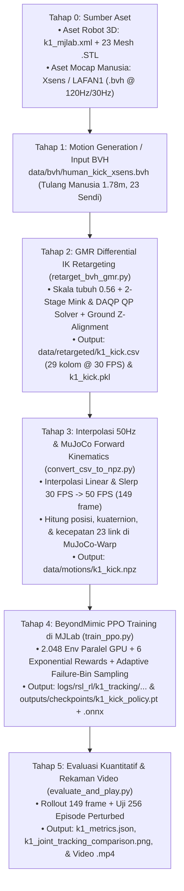
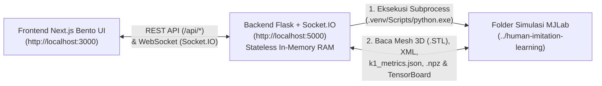

# Humanoid Imitation Learning Control & Visualization Platform — Booster K1 (22-DoF)

Platform berbasis web (**Next.js 14 Bento UI + Flask + Socket.IO + Three.js + MuJoCo**) untuk mengontrol, memantau secara *real-time* (**Stateless Ephemeral In-Memory Monitoring — Tanpa Database & Tanpa Data Dummy**), memvisualisasikan simulasi 3D, menganalisis trajektori 22 sendi, serta mengekspor video MP4 dari *pipeline* **Humanoid Whole-Body Motion Imitation Learning (`GMR + BeyondMimic + MJLab / MuJoCo-Warp`)** pada robot **Booster K1 (22-DoF)**.

---

## Daftar Isi
1. [Arsitektur & Prinsip ](#1-arsitektur--prinsip)
2. [Panduan Lengkap Folder `human-imitation-learning` Mulai Dari 0 (Asal Aset, Konversi, Training, Evaluasi)](#2-panduan-lengkap-folder-human-imitation-learning-mulai-dari-0-asal-aset-konversi-training-evaluasi)
3. [Bagaimana Backend & Frontend Terhubung ke Folder Simulasi (`human-imitation-learning`)](#3-bagaimana-backend--frontend-terhubung-ke-folder-simulasi-human-imitation-learning)
4. [Dokumentasi & Cara Menjalankan Backend (Flask + Socket.IO)](#4-dokumentasi--cara-menjalankan-backend-flask--socketio)
5. [Dokumentasi & Cara Menjalankan Frontend (Next.js Bento UI)](#5-dokumentasi--cara-menjalankan-frontend-nextjs-bento-ui)
6. [Panduan Penggunaan Frontend (FE User Guide — 9 Menu Utama)](#6-panduan-penggunaan-frontend-fe-user-guide--9-menu-utama)
7. [Referensi REST API & Event Real-Time Socket.IO](#7-referensi-rest-api--event-real-time-socketio)
8. [Panduan Upload ke GitHub & Konfigurasi `.gitignore`](#8-panduan-upload-ke-github--konfigurasi-gitignore)

---

## 1. Arsitektur & Prinsip 

Platform ini dirancang dengan dua prinsip utama:
1. **100% Data Asli dari Pipeline Simulasi (Tanpa Data Dummy / Tanpa Angka Fallback Statis)**:
   - Seluruh angka, grafik, tabel sendi, dan kartu di Frontend diambil langsung dari file hasil eksekusi MJLab di folder `human-imitation-learning`:
     - **Log TensorBoard Asli**: `logs/rsl_rl/k1_tracking/<run_dir>/events.out.tfevents.*` (`Train/mean_reward`, `Train/mean_episode_length`, `Loss/value`, `Loss/surrogate`, `Metrics/motion/error_body_pos`, `Metrics/motion/error_joint_pos`, `Episode_Reward/*`, `Episode_Termination/*`, `Perf/total_fps`).
     - **Metrik Evaluasi Kuantitatif Asli**: `outputs/evaluation/k1_metrics.json` (`joint_tracking_mae_rad`, `joint_tracking_rmse_rad`, `r_mpkpe_mm`, `mpkpe_mm`, `end_effector_hand_error_mm`, `end_effector_foot_error_mm`, `anchor_orientation_error_rad`, `success_rate_percent`, dan `per_joint_metrics` untuk 22 sendi).
     - **Trajektori Kinematik & Rollout Fisika Asli**: `data/motions/k1_kick.npz` (referensi GMR 149 frame @ 50 FPS) dan `outputs/evaluation/k1_rollout_trajectory.npz` (*rollout* tertutup *policy* PPO di MuJoCo-Warp).
     - **Telemetri Hardware Asli**: Utilisasi CPU, RAM, GPU CUDA, dan VRAM langsung dari `psutil` dan `nvidia-smi`.
   - Jika suatu metrik belum dievaluasi atau proses training sedang `idle`, UI akan menampilkan **`—`** (bukan angka karangan/dummy).
2. **Stateless Ephemeral In-Memory Monitoring (Tanpa Database)**:
   - Tidak menggunakan PostgreSQL maupun file SQLite (`.db`).
   - Seluruh status monitoring berjalan di RAM (`EphemeralRuntimeStore`). Begitu simulasi di-*reset* atau tombol **Discard Sim Buffer** ditekan, *buffer* simulasi langsung dibuang dari memori.

---

## 2. Panduan Lengkap Folder `human-imitation-learning` Mulai Dari 0 (Asal Aset, Konversi, Training, Evaluasi)

Bagian ini menjelaskan **dari nol (0)** seluruh alur di dalam folder [`../human-imitation-learning`](../human-imitation-learning): dari mana asal aset 3D robot dan gerakan manusia, bagaimana proses konversi data tahap demi tahap, hingga cara melatih dan mengevaluasi robot sampai tampil di Web Dashboard.



---

### Tahap 0: Dari Mana Asal Semua Aset Robot & Aset Gerakan Manusia?

Di dalam `human-imitation-learning`, terdapat dua jenis aset dasar:

#### A. Aset Model Robot Humanoid **Booster K1 (22-DoF)**
Berada di folder `human-imitation-learning/third_party/GMR/assets/booster_k1/`:
1. **`k1_mjlab.xml`**: File spesifikasi fisika MuJoCo (MJCF) untuk robot **Booster K1** yang mendefinisikan:
   - **Root / Anchor Body**: `Trunk` (tinggi berdiri $\approx 0.53\text{ m}$).
   - **23 Body Links** & **22 Sendi Aktif (22-DoF)**:
     - **Kepala (2-DoF)**: `AAHead_yaw`, `Head_pitch` (`Head_1`, `Head_2`).
     - **Lengan Kiri (4-DoF)**: `ALeft_Shoulder_Pitch`, `Left_Shoulder_Roll`, `Left_Elbow_Pitch`, `Left_Elbow_Yaw` (`Left_Arm_1` s/d `left_hand_link`).
     - **Lengan Kanan (4-DoF)**: `ARight_Shoulder_Pitch`, `Right_Shoulder_Roll`, `Right_Elbow_Pitch`, `Right_Elbow_Yaw` (`Right_Arm_1` s/d `right_hand_link`).
     - **Kaki Kiri (6-DoF)**: `Left_Hip_Pitch`, `Left_Hip_Roll`, `Left_Hip_Yaw`, `Left_Knee_Pitch`, `Left_Ankle_Pitch`, `Left_Ankle_Roll` (`Left_Hip_Pitch` s/d `left_foot_link`).
     - **Kaki Kanan (6-DoF)**: `Right_Hip_Pitch`, `Right_Hip_Roll`, `Right_Hip_Yaw`, `Right_Knee_Pitch`, `Right_Ankle_Pitch`, `Right_Ankle_Roll` (`Right_Hip_Pitch` s/d `right_foot_link`).
   - **Sensor IMU & Geometri Collision**: Sensor `imu_ang_vel`, `imu_lin_vel`, `imu_lin_acc` pada `Trunk`, serta geometri kapsul/kotak *collision* (`*_collision`).
2. **`meshes/*.STL`**: 23 file geometri 3D format `.STL` (`Trunk.STL`, `Head_1.STL`, `Head_2.STL`, `Left_Foot.STL`, `Right_Foot.STL`, dll.) yang dipakai oleh MuJoCo saat simulasi dan juga dikirim oleh Backend Flask ke Three.js (`RobotCanvas3D.tsx`) untuk merender robot 3D di browser.
3. **Konfigurasi Aktuator PD (`k1_constants.py`)**: Berada di `third_party/mjlab/src/mjlab/asset_zoo/robots/booster_k1/k1_constants.py`, mengatur kekakuan (*stiffness* $K_p$), redaman (*damping* $K_d$), dan batas torsi (*effort limit*) tiap motor sendi.

#### B. Aset Gerakan Manusia (*Human Motion Capture* `.bvh`)
Gerakan awal berasal dari rekaman **Motion Capture (MoCap)** manusia dalam format **`.bvh` (*Biovision Hierarchy*)**. Proyek ini mendukung 2 standar format `.bvh` populer:
1. **Format Xsens MoCap (`bvh_xsens`, 120 Hz, satuan cm)**:
   - Aset mentah bawaan GMR berada di `third_party/GMR/assets/xsens_bvh_test/251021_04_boxing_120Hz_cm_3DsMax.bvh` (kerangka manusia tinggi $1.78\text{ m}$ dengan 23 tulang manusia: `Hips`, `Chest`, `Head`, `LeftShoulder`, `LeftElbow`, `RightHip`, `RightKnee`, `RightAnkle`, dll.).
   - File gerakan tendangan **`data/bvh/human_kick_xsens.bvh`** (`360` frame @ `120 Hz`, durasi `3.0 detik`) dibangkitkan melalui skrip [`scripts/generate_kick_bvh.py`](../human-imitation-learning/scripts/generate_kick_bvh.py) yang memodulasi kerangka Xsens tersebut menggunakan kurva *C2-continuous minimum-jerk* (fase pemindahan tumpuan berat badan ke kaki kiri, *chamber* lutut kanan, ekstensi tendangan depan *front-kick*, dan *recoil* kembali berdiri).
2. **Format LAFAN1 Ubisoft (`bvh_lafan1`, 30 Hz)**:
   - Sampel tersedia di `data/bvh/lafan1_sample.bvh` (dibuat lewat `scripts/generate_lafan1_sample_bvh.py`).
   - Anda juga bisa menaruh file `.bvh` eksternal dari dataset **LAFAN1** atau **Xsens** sendiri ke dalam folder `human-imitation-learning/data/bvh/`.

---

### Tahap 1: Menyiapkan / Membuat File `.bvh` Manusia (`data/bvh/`)

Buka PowerShell dan masuk ke folder `human-imitation-learning`:
```powershell
cd C:\Users\ASUS\Documents\fp-ichiro\human-imitation-learning
```

Jika ingin membuat ulang file `.bvh` gerakan tendangan manusia dari nol:
```powershell
.\.venv\Scripts\python.exe scripts\generate_kick_bvh.py
```
- **Output**: `data/bvh/human_kick_xsens.bvh` (`360` frame @ `120 Hz`).
- **Mengapa file `.bvh` ini belum bisa langsung dipakai di robot?**
  Karena `.bvh` masih menggunakan proporsi tubuh manusia ($1.78\text{ m}$) dan derajat kebebasan sendi bola (*ball joints* 3-sumbu Euler) milik manusia, sedangkan robot **Booster K1** tingginya hanya $\approx 0.95\text{ m}$ (tinggi `Trunk` $0.53\text{ m}$) dan menggunakan 22 sendi engsel 1-sumbu (*revolute joints*).

---

### Tahap 2: Konversi & Retargeting `.bvh` Manusia $\rightarrow$ Sendi Robot `.csv` & `.pkl` via GMR (`scripts/retarget_bvh_gmr.py`)

Untuk memetakan gerakan manusia ke 22 sendi **Booster K1**, jalankan skrip [`scripts/retarget_bvh_gmr.py`](../human-imitation-learning/scripts/retarget_bvh_gmr.py):

```powershell
.\.venv\Scripts\python.exe scripts\retarget_bvh_gmr.py `
  --robot booster_k1 `
  --bvh-file data\bvh\human_kick_xsens.bvh `
  --reset-to-zero `
  --save-pkl data\retargeted\k1_kick.pkl `
  --save-csv data\retargeted\k1_kick.csv `
  --save-video outputs\videos\gmr_retargeted_k1_kick.mp4
```

#### Apa yang Terjadi di Dalam `retarget_bvh_gmr.py`?
1. **Deteksi Format & Downsampling (`120 Hz` $\rightarrow$ `30 FPS`)**:
   - Skrip otomatis mendeteksi apakah file `.bvh` berformat `xsens` atau `lafan1`, men-downsample frame dari `120 Hz` (`360` frame) menjadi `30 FPS` (`90` frame), dan mereset posisi awal $(x, y)$ serta arah hadap (*yaw*) ke titik $(0,0)$ (`--reset-to-zero`).
2. **Penskalaan Proporsi Tubuh (`human_scale_table = 0.56`)**:
   - Membaca file konfigurasi [`third_party/GMR/general_motion_retargeting/ik_configs/bvh_xsens_to_k1.json`](../human-imitation-learning/third_party/GMR/general_motion_retargeting/ik_configs/bvh_xsens_to_k1.json). Posisi target tulang manusia diskalakan dengan faktor `0.56` agar sesuai dengan panjang tungkai **Booster K1**.
3. **Two-Stage Differential Inverse Kinematics (`Mink` + `DAQP`)**:
   - Menyelesaikan masalah optimasi kuadratik (*Quadratic Programming*) dua tahap (`ik_match_table1` dan `ik_match_table2`) untuk mencari 22 sudut sendi robot yang paling mendekati posisi & orientasi tangan, siku, bahu, panggul, lutut, dan telapak kaki manusia tanpa melanggar batas sudut sendi (*joint limits*) di `k1_mjlab.xml`.
4. **Penyesuaian Kontak Lantai Otomatis (`adjust_ground_contact`)**:
   - Menghitung ketinggian $z$ terendah dari `left_foot_link` dan `right_foot_link` di MuJoCo, lalu menggeser tinggi `Trunk` supaya telapak kaki tumpu tepat menapak lantai ($z = 0.024\text{ m}$), tidak melayang dan tidak menembus lantai.
5. **Konvensi Kuaternion (`wxyz` $\rightarrow$ `xyzw`) & Penyimpanan 29 Kolom CSV**:
   - MuJoCo menyimpan rotasi root dalam urutan `[qw, qx, qy, qz]`, sedangkan `MotionLoader` MJLab membutuhkan urutan `[qx, qy, qz, qw]`. Skrip melakukan permutasi otomatis dan menghasilkan:
     - **`data/retargeted/k1_kick.csv`**: Matriks berukuran `(90 frame, 29 kolom)` @ `30 FPS` dengan susunan kolom:
       $$\underbrace{x, y, z}_{\text{3 kolom posisi Trunk}}, \underbrace{q_x, q_y, q_z, q_w}_{\text{4 kolom kuaternion Trunk}}, \underbrace{j_0, j_1, \dots, j_{21}}_{\text{22 sudut sendi (rad)}}$$
     - **`data/retargeted/k1_kick.pkl`**: Dictionary Python berisi `fps`, `root_pos`, `root_rot`, dan `dof_pos`.
     - **`outputs/videos/gmr_retargeted_k1_kick.mp4`**: Video preview hasil retargeting GMR.

---

### Tahap 3: Konversi `.csv` (30 FPS) $\rightarrow$ `.npz` (50 FPS + Forward Kinematics Lengkap) (`scripts/convert_csv_to_npz.py`)

File `.csv` dari Tahap 2 baru berisi posisi root dan 22 sudut sendi pada `30 FPS`, belum memiliki kecepatan sendi maupun posisi 3D/orientasi ke-23 bagian tubuh robot pada frekuensi kontrol *policy* `50 FPS`. Jalankan [`scripts/convert_csv_to_npz.py`](../human-imitation-learning/scripts/convert_csv_to_npz.py):

```powershell
.\.venv\Scripts\python.exe scripts\convert_csv_to_npz.py `
  --robot booster_k1 `
  --input-csv data\retargeted\k1_kick.csv `
  --output-npz data\motions\k1_kick.npz `
  --output-video outputs\videos\k1_kick_reference.mp4
```

#### Apa yang Terjadi di Dalam `convert_csv_to_npz.py`?
1. **Interpolasi Frekuensi (`30 FPS` $\rightarrow$ `50 FPS`, `149` frame)**:
   - Melakukan interpolasi linear untuk posisi root & 22 sudut sendi, serta *Spherical Linear Interpolation* (**Slerp**) untuk kuaternion rotasi root sehingga gerakan menjadi halus pada `50 FPS` ($\Delta t = 0.02\text{ detik}$, total `149` frame = `2.98 detik`).
2. **Perhitungan Kecepatan (*Finite Difference*)**:
   - Menghitung kecepatan linear root, kecepatan sudut (*angular velocity*) root, dan kecepatan sudut 22 sendi (`joint_vel`).
3. **Rollout Forward Kinematics di MuJoCo-Warp (`sim.forward()`)**:
   - Memasukkan state setiap frame ke dalam scene MuJoCo `booster_k1_flat_tracking_env_cfg` dan memanggil `sim.forward()` untuk merekam posisi 3D dunia, kuaternion orientasi, serta kecepatan seluruh **23 body links** robot.
4. **Isi File Output `data/motions/k1_kick.npz`**:
   File `.npz` inilah yang menjadi **input utama** untuk simulasi, training PPO, dan visualisasi 3D di Web:
   - `fps`: `(1,)` = `[50]`
   - `joint_pos`: `(149, 22)` (`float32`, sudut referensi 22 sendi dalam radian)
   - `joint_vel`: `(149, 22)` (`float32`, kecepatan sudut referensi 22 sendi dalam rad/s)
   - `body_pos_w`: `(149, 23, 3)` (`float32`, posisi 3D $(x,y,z)$ seluruh 23 link di koordinat dunia)
   - `body_quat_w`: `(149, 23, 4)` (`float32`, kuaternion `[w, x, y, z]` seluruh 23 link)
   - `body_lin_vel_w`: `(149, 23, 3)` (`float32`, kecepatan linear 23 link)
   - `body_ang_vel_w`: `(149, 23, 3)` (`float32`, kecepatan sudut 23 link)

---

### Tahap 4: Menjalankan Training PPO BeyondMimic di MJLab (`scripts/train_ppo.py`)

File `data/motions/k1_kick.npz` dari Tahap 3 masih berupa gerakan kinematik (tanpa gravitasi dan tanpa gaya kontak kaki). Agar robot **Booster K1** dapat mengeksekusi tendangan tersebut secara seimbang di bawah hukum fisika penuh (gravitasi, gesekan lantai, batas torsi motor PD, dan gangguan dorongan), kita melatih jaringan saraf **Actor-Critic PPO** menggunakan [`scripts/train_ppo.py`](../human-imitation-learning/scripts/train_ppo.py):

```powershell
.\.venv\Scripts\python.exe scripts\train_ppo.py `
  --robot booster_k1 `
  --motion-file data\motions\k1_kick.npz `
  --num-envs 2048 `
  --max-iterations 500 `
  --save-interval 100 `
  --run-name beyondmimic_k1_kick `
  --output-checkpoint outputs\checkpoints\k1_kick_policy.pt
```

- **Cara Melanjutkan Training (*Finetuning* / `--resume-from`)**:
  Untuk menambah iterasi latihan dari checkpoint terakhir agar keseimbangan satu kaki makin kokoh:
  ```powershell
  .\.venv\Scripts\python.exe scripts\train_ppo.py `
    --robot booster_k1 `
    --motion-file data\motions\k1_kick.npz `
    --resume-from outputs\checkpoints\k1_kick_policy.pt `
    --num-envs 2048 `
    --max-iterations 500 `
    --save-interval 100 `
    --run-name beyondmimic_k1_kick_finetune `
    --output-checkpoint outputs\checkpoints\k1_kick_policy.pt
  ```
- **Output Training**:
  - Folder log TensorBoard & checkpoint berkala (`model_0.pt`, `model_100.pt`, ...) di `logs/rsl_rl/k1_tracking/<timestamp>_<run_name>/`.
  - Checkpoint final disalin otomatis ke `outputs/checkpoints/k1_kick_policy.pt` beserta model inferensi `outputs/checkpoints/k1_kick_policy.onnx`.

---

### Tahap 5: Evaluasi Kuantitatif & Perekaman Video (`scripts/evaluate_and_play.py`)

Setelah training selesai, jalankan [`scripts/evaluate_and_play.py`](../human-imitation-learning/scripts/evaluate_and_play.py) untuk menguji *policy* pada trajektori penuh (149 frame) sekaligus pada 256 episode paralel dengan gangguan (*pose perturbations*):

```powershell
.\.venv\Scripts\python.exe scripts\evaluate_and_play.py `
  --robot booster_k1 `
  --checkpoint-file outputs\checkpoints\k1_kick_policy.pt `
  --motion-file data\motions\k1_kick.npz `
  --output-video outputs\videos\k1_trained_policy_tracking.mp4 `
  --output-metrics outputs\evaluation\k1_metrics.json `
  --output-plot outputs\evaluation\k1_joint_tracking_comparison.png
```
Dan untuk membuat grafik kurva training serta video perbandingan *side-by-side*:
```powershell
.\.venv\Scripts\python.exe scripts\plot_training_curves.py
.\.venv\Scripts\python.exe scripts\create_comparison_video.py
```

> **Tip: Menjalankan Seluruh Tahap 2 s/d 5 Sekaligus dengan 1 Perintah**:
> Anda juga dapat menjalankan skrip orkestrator [`scripts/run_full_pipeline.py`](../human-imitation-learning/scripts/run_full_pipeline.py):
> ```powershell
> .\.venv\Scripts\python.exe scripts\run_full_pipeline.py --bvh-file data\bvh\human_kick_xsens.bvh --num-envs 2048 --max-iterations 500
> ```

---

## 3. Bagaimana Backend & Frontend Terhubung ke Folder Simulasi (`human-imitation-learning`)

Hubungan antara **Frontend (`Port 3000`)**, **Backend (`Port 5000`)**, dan **Folder Simulasi (`human-imitation-learning`)** berjalan secara **otomatis dan langsung (*direct integration*)**:



### Jembatan Konfigurasi di `backend/config.py`
Pada file [`backend/config.py`](./backend/config.py), backend secara otomatis mendeteksi lokasi folder `human-imitation-learning`:

```python
BACKEND_DIR = pathlib.Path(__file__).resolve().parent
PROJECT_ROOT = BACKEND_DIR.parent
WORKSPACE_ROOT = PROJECT_ROOT.parent
HIL_ROOT = (WORKSPACE_ROOT / "human-imitation-learning").resolve()
```

Dari `HIL_ROOT` tersebut, Backend langsung memetakan seluruh file hasil Tahap 0 s/d Tahap 5 di atas:
1. **`PYTHON_EXE`** $\rightarrow$ `human-imitation-learning/.venv/Scripts/python.exe`.
2. **`SCRIPTS_DIR`** $\rightarrow$ `human-imitation-learning/scripts/` (`train_ppo.py` dan `evaluate_and_play.py` dijalankan langsung sebagai subprocess saat Anda menekan tombol di halaman **Training Center**).
3. **`K1_MESHES_DIR` & `K1_XML_PATH`** $\rightarrow$ `third_party/GMR/assets/booster_k1/` (mengirimkan 23 file `.STL` asli ke Three.js 3D Viewer).
4. **`MOTIONS_DIR` & `EVALUATION_DIR`** $\rightarrow$ `data/motions/k1_kick.npz`, `outputs/evaluation/k1_rollout_trajectory.npz`, dan `outputs/evaluation/k1_metrics.json`.
5. **`LOGS_DIR` & `CHECKPOINTS_DIR`** $\rightarrow$ `logs/rsl_rl/k1_tracking/` (membaca file `events.out.tfevents.*` TensorBoard secara langsung ke RAM) dan `outputs/checkpoints/k1_kick_policy.pt`.

---

## 4. Dokumentasi & Cara Menjalankan Backend (Flask + Socket.IO)

Buka terminal **PowerShell** dan jalankan menggunakan Python dari `.venv` simulasi:

```powershell
cd C:\Users\ASUS\Documents\fp-ichiro\monitoring-control-imitation
..\human-imitation-learning\.venv\Scripts\python.exe backend\run.py
```
*(Atau cukup jalankan skrip `.\start_backend.ps1`)*

- Server Backend akan aktif di: **`http://localhost:5000`**
- Cek kesehatan server di browser: **`http://localhost:5000/api/health`**

---

## 5. Dokumentasi & Cara Menjalankan Frontend (Next.js Bento UI)

1. **(Hanya Pertama Kali)** Instal dependensi Node.js:
   ```powershell
   cd C:\Users\ASUS\Documents\fp-ichiro\monitoring-control-imitation\frontend
   npm install
   ```
2. Jalankan server *development* Next.js:
   ```powershell
   npm run dev
   ```
   *(Atau jalankan `.\start_frontend.ps1` dari folder `monitoring-control-imitation`)*
3. Buka browser dan akses: **`http://localhost:3000`**

> **Menjalankan Backend + Frontend Sekaligus (1 Perintah)**:
> ```powershell
> cd C:\Users\ASUS\Documents\fp-ichiro\monitoring-control-imitation
> .\start_platform.ps1
> ```

---

## 6. Panduan Penggunaan Frontend (FE User Guide — 9 Menu Utama)

Bagian atas aplikasi (**Live System & Socket.IO Status Header**) menampilkan status koneksi WebSocket (`SOCKET.IO LIVE` / `REST POLLING`), status proses training aktif (`IDLE` / `RUNNING` / `PAUSED`), serta pemakaian **CPU, RAM, GPU, dan VRAM** secara *real-time*.

1. **`Dashboard` (Overview Bento Grid — 100% Data Asli)**:
   - **Hero TensorBoard Convergence Card**: Grafik perbandingan `Train/mean_reward` vs `Metrics/motion/error_body_pos (m)` dari TensorBoard, dilengkapi **Peak Logged Reward**, **Evaluated R-MPKPE / World MPKPE**, dan **Latest Mean Episode Length**.
   - **Joint Position & Velocity Tracking Error** & **End-Effector & Anchor Orientation Error**: Menampilkan `joint_tracking_mae_rad`, `joint_tracking_rmse_rad`, `joint_velocity_rmse_rad_s`, `end_effector_hand_error_mm`, `end_effector_foot_error_mm`, dan `anchor_orientation_error_deg` dari `k1_metrics.json`.
   - **22-DoF Group MAE, Motion Completion Gauge, & Evaluation Metrics Summary**: Analisis error per kelompok sendi dan tingkat penyelesaian episode (`168 / 256` episode).
   - **Active Policy Checkpoint & 6 Tombol Camera POV (`3P`, `FR`, `SD`, `TP`, `OR`, `FP`)**: Pintasan langsung ke 3D Simulation Viewer dan daftar run TensorBoard asli.
2. **`Training Center`**: Mengatur parameter dan mengeksekusi `train_ppo.py` (*Start PPO*, *Pause*, *Resume*, *Stop*) serta `evaluate_and_play.py` (*Evaluate Policy*) lengkap dengan *live terminal stdout stream*.
3. **`3D Simulation`**: Visualisasi 3D robot **Booster K1** dengan 23 mesh `.STL` asli, mode *Side-by-Side* / *Ghost Overlay*, *Error Heatmap*, **6 Camera POV** (termasuk `First-Person Head_2 POV`), **MuJoCo Native Stream**, dan tombol **Reset & Discard Buffer**.
4. **`Motion Analysis`**: Grafik sudut sendi, error $|q_{\text{sim}}(t) - q_{\text{ref}}(t)|$, kecepatan sudut sendi, ketinggian kaki tendang `right_foot_link` Z, dan tabel 22-DoF.
5. **`Analytics & Plots`**: 12 kartu metrik evaluasi & TensorBoard, kurva 6 *Exponential Tracking Rewards*, *Curriculum Sampling Entropy*, perbandingan *checkpoint*, serta ekspor **CSV**, **JSON**, dan **Matplotlib Report PNG**.
6. **`Video Studio`**: Pembuatan video `.mp4` latar belakang via MuJoCo + FFmpeg untuk semua mode dan 6 Camera POV.
7. **`Experiments`**, 8. **`Checkpoints`**, & 9. **`System Settings`**: Manajemen sesi & log TensorBoard, unduh `.PT` / `.ONNX`, serta informasi *path* integrasi MJLab.

---

## 7. Referensi REST API & Event Real-Time Socket.IO

| Method | Endpoint | Deskripsi |
| :--- | :--- | :--- |
| `GET` | `/api/health` | Status kesehatan server backend & mode *storage* (`ephemeral_in_memory_no_database`). |
| `GET` | `/api/dashboard/overview` | Data asli `k1_metrics.json`, ringkasan run TensorBoard, performa 22 sendi, & telemetri hardware. |
| `GET` | `/api/training/options` | Daftar robot, environment MJLab, dataset `.npz`, `.csv`, `.bvh`, dan daftar *checkpoint*. |
| `GET` | `/api/training/status` | Status proses training aktif (`idle`, `running`, `paused`, `completed`), PID, & utilisasi CPU/GPU. |
| `POST` | `/api/training/start` | Memvalidasi parameter & menjalankan subprocess `scripts/train_ppo.py`. |
| `POST` | `/api/training/pause` | Membekukan (*suspend*) proses training yang sedang berjalan. |
| `POST` | `/api/training/resume` | Melanjutkan proses training yang sedang dibekukan. |
| `POST` | `/api/training/stop` | Menghentikan proses training dengan aman. |
| `POST` | `/api/training/evaluate` | Menjalankan evaluasi `scripts/evaluate_and_play.py` di latar belakang. |
| `GET` | `/api/simulation/schema` | Skema kinematik 23 *body links*, 22 sendi, 14 *keybodies*, dan daftar mesh `.STL` Booster K1. |
| `GET` | `/api/simulation/meshes/<file>` | Mengirimkan file mesh 3D `.STL` asli Booster K1. |
| `GET` | `/api/simulation/trajectory` | Data trajektori 149 frame @ 50 FPS (`ref` vs `sim`), error per sendi/body, & pose kamera `Head_2`. |
| `GET` | `/api/simulation/render-frame` | Merender frame kamera MuJoCo C++ offscreen (JPEG Base64) untuk 6 mode POV. |
| `POST` | `/api/simulation/discard` | Langsung membuang *buffer* dan *cache* simulasi dari memori (ephemeral mode). |
| `GET` | `/api/analytics/summary` | Metrik evaluasi asli `k1_metrics.json` & deret scalar TensorBoard. |
| `GET` | `/api/analytics/export` | Unduh hasil eksperimen dalam format `CSV` atau `JSON`. |
| `GET` | `/api/analytics/report.png` | Render grafik laporan konvergensi 4-panel via `Matplotlib`. |
| `POST` | `/api/videos/generate` | Menjalankan *background job* pembuatan video MP4 MuJoCo + FFmpeg. |
| `GET` | `/api/videos/stream/<id>` | Streaming video MP4 untuk preview HTML5 `<video>`. |
| `GET` | `/api/videos/download/<id>` | Mengunduh file video MP4. |

---

## 8. Panduan Upload ke GitHub & Konfigurasi `.gitignore`

File `.gitignore` telah disiapkan di [`fp-ichiro/.gitignore`](../.gitignore), [`monitoring-control-imitation/.gitignore`](./.gitignore), [`monitoring-control-imitation/frontend/.gitignore`](./frontend/.gitignore), dan [`human-imitation-learning/.gitignore`](../human-imitation-learning/.gitignore) untuk mengabaikan file rahasia (`.env*`, `*.key`), runtime lokal (`.venv/`, `.python/`, `node_modules/`, `.next/`), serta file biner/dataset besar (`*.pt`, `*.onnx`, `*.npz`, `*.pkl`, `*.bvh`, `*.mp4`, `logs/`).
